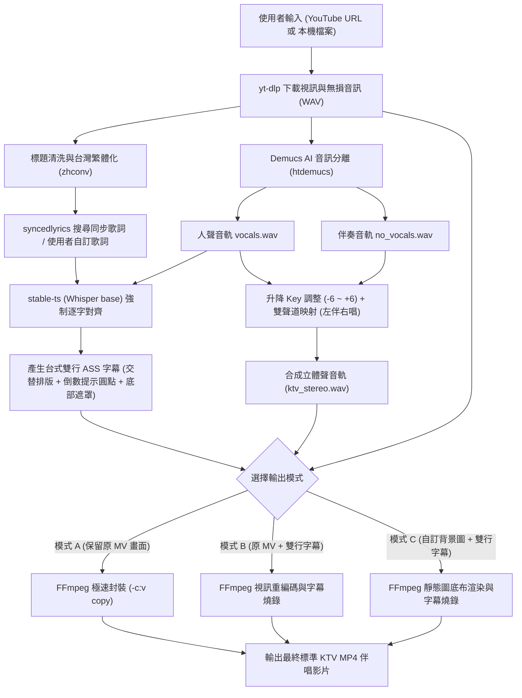

# AI KaraSong (AI 全自動台式 KTV 伴奏與雙行字幕製作工具)


-orange)
-red)


專為 Windows 本地端打造的 **「YouTube 轉台式 KTV 伴奏與雙行字幕全自動製作工具 (AI KaraSong)」**。  
只要貼上 YouTube 影片網址（或選取本機影音檔案），即可一鍵全自動完成：高畫質影音下載 ➔ AI 伴奏與人聲分離 ➔ 歌詞繁體化與 AI 逐字強制對齊 ➔ 產生台式雙行變色字幕 ➔ 升降 Key 調整 ➔ 封裝成「**左聲道伴奏、右聲道原唱**」的標準 KTV 伴唱影片 (MP4)。

---

## 🌟 核心特色功能

### 1. 智慧畫面與字幕策略（三大模式）
- **【模式 A：保留原 MV 畫面（不壓新字幕）】**：
  - 適用原本畫面上就已帶有字幕的官方 MV。
  - 僅抽換音軌為「左聲道伴奏、右聲道原唱（支援升降 Key）」。
  - 視訊流直接使用 `-c:v copy` 極速封裝，**1~3 秒內極速出片**！
- **【模式 B：保留原 MV 畫面 + 疊加台式雙行變色字幕】**：
  - 適用無字幕純享版 MV 或 Official Audio。
  - 在畫面底部疊加半透明黑底遮罩（確保亮色背景依然清晰可見）。
  - 精確燒錄台式雙行逐字變色字幕 (`.ass`)。
- **【模式 C：自訂黑底/背景圖 + 疊加台式雙行變色字幕】**：
  - 純音訊輸入，可指定本機背景圖片（或預設 1080p 純黑底底布）。
  - 自動生成標準卡拉 OK 伴唱影片。

### 2. 正宗台式 KTV 雙行變色字幕規範（好樂迪 / 錢櫃風格）
- **雙行交替與提前預顯（Lead-in Preview）**：
  - 上行（奇數行）與下行（偶數行）交替顯示，下行向右錯位縮排。
  - 歌詞於演唱前 2.5 秒以白字（未唱狀態）提前出現在畫面上，讓演唱者能從容預讀。
- **逐字平滑變色 (`\kf`)**：
  - 字幕依據演唱節奏平滑由未唱色（純白）刷為已唱色（如經典天藍/青色、浪漫粉桃、璀璨金黃）。
- **前奏/間奏 4 拍節奏倒數圓點 (`● ● ● ●`)**：
  - 當前奏或間奏空白時間超過 3.5 秒時，自動於歌詞上方喚出 4 顆提示節奏圓點。
  - 隨節奏逐拍變色倒數，第 4 拍倒數結束精準無縫接上第一字演唱！
- **半透明防反光黑底遮罩 (Bottom Mask)**：
  - 底部自動鋪設約 46% 遮光度的漸層黑底遮罩，徹底解決 MV 背景過亮導致字幕看不清的問題。

### 3. AI 人聲分離與高精度音訊對齊
- **Demucs (htdemucs)**：業界領先的 AI 人聲伴奏分離引擎，分離出高純度 `vocals.wav` 與 `no_vocals.wav`。
- **stable-ts (Whisper)**：載入 `base` 模型，將人聲音軌與歌詞文本進行強制對齊 (`align()`)，取得毫秒級字元時間軸。
- **雙層容錯安全網**：即便歌曲無提供歌詞或對齊特殊段落，系統具備智慧回退機制，使用 LRC 時間軸自動微秒內插，保證製作流程 100% 順暢不中斷。

### 4. 標準台式 KTV 雙聲道與升降 Key (Pitch Shifting)
- **正宗台式 KTV 聲道配置**：
  - **左聲道 (Left Channel / FL - 純伴唱聲道)**：100% 純伴奏音樂 (`no_vocals.wav`)，完全消除人聲，適合卡拉 OK 拿起麥克風演唱。
  - **右聲道 (Right Channel / FR - 導唱/原唱聲道)**：伴奏音樂 + 原唱人聲混合 (`no_vocals.wav` + `vocals.wav`)，保留完整的歌曲伴奏與原唱，絕非乾澀的單耳清唱！
  - 播放時使用播放器（如 PotPlayer、VLC）切換「僅播放左聲道」或「僅播放右聲道」，即可在「純伴奏卡拉 OK」與「原曲聽歌導唱」間任意切換。
- **升降 Key 調整**：支援 -6 到 +6 半音調整，精準調整歌曲音高。

### 5. 獨立外置核心目錄 (`bin/`)
- 統一調用本機 `./bin/yt-dlp.exe` 與 `./bin/ffmpeg.exe`。
- 介面提供「**更新下載核心**」按鈕，隨時執行 `yt-dlp.exe -U` 自動線上升級，從容應對 YouTube 演算法更新。

---

## 🛠️ 系統架構流程圖



---

## 📂 專案目錄結構

```text
AI-KaraSong/
├── bin/                          # 外置核心執行檔目錄
│   ├── ffmpeg.exe               # 音視訊編碼合成核心
│   ├── ffprobe.exe              # 媒體屬性偵測核心
│   └── yt-dlp.exe               # YouTube 下載核心 (支援介面一鍵 -U 更新)
├── icon/                         # 應用程式與視窗品牌圖示
│   ├── icon.ico                 # 視窗與工作列多尺寸圖示
│   └── ICON.png                 # 高畫質 Logo 原圖
├── core/                         # 核心邏輯處理模組
│   ├── __init__.py
│   ├── config.py                # 系統常數、路徑、配色風格設定
│   ├── downloader.py            # yt-dlp 下載、中繼資訊解析、核心更新
│   ├── lyrics_manager.py        # 標題清洗、syncedlyrics 檢索、繁體轉換
│   ├── separator.py             # Demucs 人聲伴奏深度分離
│   ├── aligner.py               # stable-ts 逐字強制對齊與容錯回退
│   ├── subtitle_generator.py    # 台式雙行 KTV ASS 字幕、倒數圓點生成
│   ├── audio_processor.py       # 升降 Key 與左伴右唱立體聲混音
│   ├── video_composer.py        # 模式 A/B/C FFmpeg 影片壓製
│   └── pipeline.py              # 全流程調度協調器
├── gui/                          # CustomTkinter 現代深色系圖形介面
│   ├── __init__.py
│   └── app.py                   # 介面主體、背景執行緒排程、即時 Log 視窗
├── output/                       # 最終 KTV 伴唱影片預設輸出目錄
├── temp/                         # 暫存快取目錄
├── main.py                       # 程式主入口
├── 啟動AI KaraSong.bat           # Windows 一鍵捷徑啟動腳本
└── requirements.txt              # Python 套件清單
```

---

## 🚀 快速開始

### 1. 安裝環境依賴
確保已安裝 Python 3.10+，於本專案目錄執行：
```bash
pip install -r requirements.txt
```

### 2. 啟動程式
可以直接雙擊執行：
```bash
啟動AI KaraSong.bat
```
或在終端機中執行：
```bash
python main.py
```

### 3. 使用步驟
1. **貼上網址**：複製 YouTube 歌曲網址並點擊「貼上」，亦可點選「選取本機檔案」。
2. **選擇模式**：
   - 模式 A（原 MV 自帶字幕，秒速抽取替換雙聲道）。
   - 模式 B（原 MV 無字幕，疊加雙行變色字幕與黑底遮罩）。
   - 模式 C（以自訂圖片或黑底製作標準伴唱影片）。
3. **設定伴奏調性**：拖動「升降 Key」滑桿（例如升 2 半音、降 1 半音）。
4. **檢查歌詞**：點擊「解析歌曲與搜尋歌詞」，可預覽並編輯歌詞，亦可點擊「一鍵轉台灣繁體」。
5. **開始製作**：點擊「🚀 開始一鍵全自動製作」，進度條與下方 Log 視窗會即時更新進度。
6. **驗收成果**：製作完成後可直接點擊「▶️ 播放成果」或「📂 開啟輸出資料夾」。

---

## 🎧 播放與伴唱切換技巧

本軟體產出之標準台式 KTV MP4 伴唱影片採用正統立體聲雙軌架構：
- **純伴奏模式（卡拉 OK 伴唱）**：
  在播放器（如 PotPlayer、VLC、KMPlayer 等）將音訊聲道設定為「**僅播放左聲道 (Left Channel / FL)**」或將聲道平衡拉至最左，即可享受 100% 純伴奏音樂，完全無原唱人聲干擾。
- **導唱/原唱模式（跟唱練習/日常聽歌）**：
  將聲道設定為「**僅播放右聲道 (Right Channel / FR)**」或將聲道平衡拉至最右，即可聆聽原唱人聲與背景伴奏音樂的完整原曲混音。
- **立體聲雙聲道（一般鑑賞）**：
  不切換聲道時，左右耳分別為純伴奏與導唱混音，雙耳皆有飽滿伴奏包覆，人聲自然定位，層次分明。
